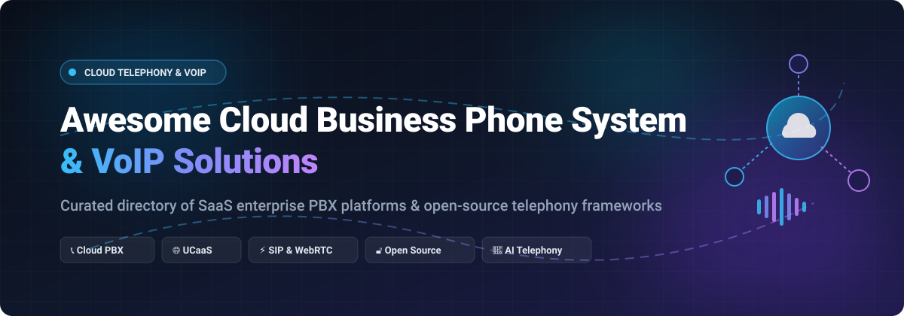

  

# Awesome Cloud Business Phone System &amp; VoIP 📞☁️

  
  
  
  
  
  
  

> 🎯 **A curated directory of top Cloud Business Phone Systems, Hosted Cloud PBX solutions, Unified Communications (UCaaS), and Open-Source VoIP / SIP Telephony Engines.**  
> *Everything you need for enterprise business telephony, virtual phone numbers, interactive voice response (IVR), call routing, WebRTC, SIP trunking, and conversational AI voice integration.*

---

## 📑 Table of Contents
- [🔍 Sector Overview &amp; Market Dynamics](#-sector-overview--market-dynamics)
- [🏢 SaaS &amp; Hosted Cloud Phone Platforms](#-saas--hosted-cloud-phone-platforms)
- [🔓 Open-Source Telephony &amp; PBX Projects](#-open-source-telephony--pbx-projects)
- [🛠️ Architecture &amp; Key Features Checklist](#️-architecture--key-features-checklist)
- [🤝 How to Contribute](#-how-to-contribute)
- [💖 Support &amp; Sponsorship](#-support--sponsorship)
- [📈 Star History](#-star-history)
- [⚖️ Disclaimer](#️-disclaimer)

---

## 🔍 Sector Overview &amp; Market Dynamics

The global **Cloud PBX and Business VoIP market** is experiencing unprecedented acceleration, currently valued at **$18B–$20B** (with the broader worldwide VoIP ecosystem exceeding **$170B** and projected to climb past **$300B+** by the early 2030s at an estimated compound annual growth rate of ~15–18.5%). 

- 🏛️ **Top-Tier Concentration (UCaaS Giants):** The enterprise market shows **moderate concentration** around dominant multi-channel communications providers (such as Zoom Workplace, RingCentral MVP, Vonage, 8x8, and Cisco Webex). These vendors bundle voice calling with video conferencing, AI meeting summaries, and enterprise CRM integrations.
- 🌐 **SMB &amp; Regional Fragmentation:** Conversely, the small-and-medium business (SMB) and developer telephony tiers remain **highly fragmented**. Hundreds of local telecom operators, specialized virtual phone providers (e.g., Grasshopper, Zoho Voice, Nextiva), and self-hosted open-source software (FreeSWITCH, Asterisk, Kamailio) thrive by serving custom regional telephony compliance, data sovereignty, and cost-optimized infrastructure needs.

---

## 🏢 SaaS &amp; Hosted Cloud Phone Platforms

A comparison of leading commercial cloud business phone systems, detailing company scale, starting tier pricing, and free trial / free tier terms:

| Product | Scale (Revenue / Valuation) | Pricing (Starting Tier) | Free Tier / Trial Limits | Description &amp; Highlights |
|:---|:---|:---|:---|:---|
| **[Zoom Phone](https://www.zoom.us/)** | 📈 ~$28B Market Cap *(~$4.87B Annual Rev)* | **$10.00** / user / month *(Metered, annual billing)* or **$15.00** / user / month *(Unlimited US/Canada)* | **100-minute free trial** for Virtual Agent Receptionist; pay-as-you-go outbound metered option (no permanent free unlimited tier) | Modern cloud phone system natively integrated into Zoom Workplace. Features IVR auto attendants, call recording, visual voicemail transcription, and AI Companion meeting summaries. |
| **[Zoho Voice](https://www.zoho.com/voice/)** | 🦄 ~$12.5B Valuation *(~$1.4B–$1.5B Annual Rev)* | **$10.00** / user / month *(Business Phone Team, billed annually for 10 users @ $100/mo)* | 🟢 **Solo (Free Forever)**: 1 user, 250 free outgoing mins/mo, single-level IVR, basic call analytics, and web dialer (standard outbound rates apply past limit) | Cloud telephony deeply connected with Zoho CRM, Zoho Desk, and Zoho Flow. Delivers multi-level IVR, call recording, SMS/MMS, and Bring Your Own Carrier (BYOC) capability. |
| **[Vonage Business Communications](https://www.vonage.com/)** | 🏛️ $6.2B Acquisition (Ericsson) *(~$1.2B+ Annual Rev)* | **$13.99** / line / month *(Mobile plan, annual)* or **$19.99** / line / month *(Monthly)* | **14-day free trial** for up to 99 lines *(US only, self-service online registration; no permanent free tier)* | Unified cloud PBX featuring cross-platform desktop/mobile softphones, unlimited calls/SMS in the US/Canada, virtual auto attendant, and 50+ business integrations. |
| **[RingCentral MVP](https://www.ringcentral.com/)** | 📈 ~$6.0B Market Cap *(~$2.62B Annual Rev)* | **$20.00** / user / month *(Core plan, billed annually)* or **$30.00** / user / month *(Monthly)* | **14-day free trial** on Core &amp; Advanced tiers *(Up to 5 users, includes 50 domestic outbound minutes; no credit card for first 7 days)* | Enterprise unified communications powerhouse (RingEX) providing HD voice calling, business SMS (25 messages/user/mo on Core), video meetings (up to 100 participants), and RingSense AI. |
| **[GoTo Connect](https://www.goto.com/)** | 💼 $4.3B PE Buyout *(~$1.0B–$1.4B Annual Rev)* | **$26.00** / user / month *(Phone System plan, billed annually)* or **$32.00** / user / month *(Monthly)* | **14-day free trial** with full feature access *(No credit card required; automatically lapses without charges; no permanent free tier)* | All-in-one cloud phone system featuring a drag-and-drop visual dial plan editor, video meetings, team messaging, smart routing, and customer engagement call queues. |
| **[Nextiva](https://www.nextiva.com/)** | 🦄 $2.7B Valuation *(~$250M–$350M Annual Rev)* | **$15.00** / user / month *(Core plan, billed annually)* or **$23.00** / user / month *(Monthly)* | **14-day free trial** on select tools; 30-day money-back guarantee on full subscription packages *(No permanent free tier)* | Scalable business communications platform pairing VoIP phone service with video meetings, team collaboration, virtual fax, and CRM integrations for SMBs. |
| **[Dialpad](https://www.dialpad.com/)** | 🦄 $2.2B Valuation *(~$300M ARR)* | **$15.00** / user / month *(Standard plan, billed annually)* or **$23.00** / user / month *(Monthly)* | **14-day free trial** on Standard &amp; Pro tiers *(Includes unlimited domestic calling, SMS, video meetings, and live AI transcription; no permanent free tier)* | AI-first communications platform with real-time speech-to-text, sentiment detection, automated call summaries, and seamless Google Workspace / Microsoft 365 syncing. |
| **[Ooma Office](https://www.ooma.com/)** | 📈 ~$500M Market Cap *(~$280M–$300M Annual Rev)* | **$19.95** / user / month *(Essentials plan, no long-term contract)* | No software free trial; 30-day money-back guarantee on hardware with flexible month-to-month contracts *(No cancellation penalty)* | Accessible small-business VoIP solution with pre-configured virtual receptionist, ring groups, mobile/desktop calling, e-fax, and transparent per-user billing. |
| **[8x8](https://www.8x8.com/)** | 📈 ~$320M Market Cap *(~$740M Annual Rev)* | **$15.00** / user / month *(8x8 Express plan, billed annually)* | **30-day free trial** on 8x8 Express tier *(Includes 1 business phone number, unlimited US/Canada calling, and team chat; no permanent free tier)* | Cloud PBX and contact center solution offering international calling reach, team messaging, video conferencing, and multi-channel customer communications. |
| **[Grasshopper](https://grasshopper.com/)** | 💼 ~$80M Annual Rev *(GoTo subsidiary, $4.3B parent)* | **$14.00** / account / month *(True Solo, billed annually)* or **$18.00** / account / month *(Monthly)* | **7-day free trial** *(Includes 1 business number, 3 extensions, and 50 minutes/100 texts; no credit card required; no permanent free tier)* | Virtual phone number app for entrepreneurs, freelancers, and small businesses that layers business calling, vanity numbers, and auto attendants on top of existing cellular lines. |

---

## 🔓 Open-Source Telephony &amp; PBX Projects

*Self-hosted open-source PBX servers, SIP proxies, Session Border Controllers (SBC), and WebRTC gateways. Sorted by GitHub stargazers (descending).*

| Project | Stars_Badge | Description |
|:---|:---:|:---|
| **[Janus WebRTC Gateway](https://github.com/meetecho/janus-gateway)** |  | General-purpose, lightweight WebRTC gateway by Meetecho. Bridges browser-based real-time media streams to SIP backends, PBXs, and RTP streaming servers. |
| **[Fonoster](https://github.com/fonoster/fonoster)** |  | Open-source alternative to Twilio. Programmable telecommunications framework allowing developers to deploy voice agents, programmable IVRs, and SIP routing via modern APIs. |
| **[FreeSWITCH](https://github.com/signalwire/freeswitch)** |  | High-performance, multi-protocol telephony platform routing audio, video, and text from SIP to WebRTC. Powers carrier-grade softswitches, SBCs, and multi-tenant PBXs. |
| **[Asterisk](https://github.com/asterisk/asterisk)** |  | The historic pioneer and most widely deployed open-source PBX framework. Powers FreePBX, Issabel, and commercial phone systems with rich modules for IVR, queues, and SIP trunks. |
| **[Kamailio](https://github.com/kamailio/kamailio)** |  | Carrier-grade open-source SIP server handling thousands of call setups per second. Serves as a high-volume SIP proxy, registrar, load balancer, and secure SBC. |
| **[JsSIP](https://github.com/versatica/JsSIP)** |  | Pure JavaScript SIP library built for WebRTC and modern web browsers. Enables browser softphones, web dialers, and real-time audio/video sessions over WebSocket. |
| **[SIP.js](https://github.com/onsip/SIP.js)** |  | Comprehensive JavaScript SIP library leveraging WebRTC to establish media calls and signaling directly with Asterisk, FreeSWITCH, or commercial SIP backends. |
| **[HOMER](https://github.com/sipcapture/homer)** |  | Carrier-grade packet capture, troubleshooting, and call quality monitoring system for SIP, VoIP, and RTC protocols. Generates call ladder flows and RTCP quality graphs. |
| **[OpenSIPS](https://github.com/OpenSIPS/opensips)** |  | Ultra-fast SIP proxy/server for carrier deployments, routing engines, and SBCs. Built for multi-tenant scalability, routing logic scripts, and high-concurrency environments. |
| **[FusionPBX](https://github.com/fusionpbx/fusionpbx)** |  | Multi-tenant graphical web interface for FreeSWITCH. Provides enterprise PBX capabilities, extension management, visual IVRs, call recording, and multi-domain hosting. |
| **[rtpengine](https://github.com/sipwise/rtpengine)** |  | High-speed RTP/SRTP media proxy by Sipwise. Translates between legacy VoIP codecs/encryption and browser WebRTC (DTLS-SRTP / ICE) with kernel-level forwarding. |
| **[Drachtio](https://github.com/drachtio/drachtio-server)** |  | Modern SIP application server that empowers developers to build VoIP microservices and automated call control workflows in Node.js and TypeScript. |
| **[FreePBX (Core)](https://github.com/FreePBX/core)** |  | The core telephony configuration engine and web GUI for Asterisk, managing inbound routes, queues, extensions, and trunks for millions of PBX installations worldwide. |
| **[Issabel](https://github.com/IssabelFoundation/issabel)** |  | Unified communications Linux distribution bringing Asterisk, webphone dialers, call center modules, email, and fax into a single turnkey self-hosted ISO. |

---

## 🛠️ Architecture &amp; Key Features Checklist

When choosing between a hosted SaaS PBX or an open-source self-hosted setup, consider these essential capabilities:

- [x] **Virtual Phone Numbers &amp; Portability:** Local, toll-free, and international DIDs with 10DLC TCR compliance for SMS/MMS.
- [x] **Smart Call Routing &amp; Multi-Level IVR:** Time-based rules, skill-based routing, ring groups, and custom digital receptionists.
- [x] **Modern Client Applications:** WebRTC browser softphones, desktop clients (Windows/macOS/Linux), and mobile apps (iOS/Android).
- [x] **AI-Powered Speech Services:** Real-time speech-to-text, voicemail transcription, sentiment analysis, and conversational AI voice agents.
- [x] **Carrier Flexibility &amp; BYOC:** Ability to connect your own SIP trunks (e.g., Twilio, Telnyx, Bandwidth) to optimize calling rates.
- [x] **Security &amp; Encryption:** TLS signaling, SRTP audio encryption, Fail2Ban toll fraud protection, and strict access controls.

---

## 🤝 How to Contribute

Contributions are warmly welcome! To propose updates or add new platforms:

1. 🍴 **Fork the repository** to your GitHub account.
2. 🌿 **Create a feature branch**: `git checkout -b feature/add-new-telephony-platform`.
3. 📝 **Add or update the table entry** in `README.md` maintaining exact table structure, pricing clarity, and verified stargazers badges.
4. 🚀 **Submit a Pull Request** with a brief summary explaining why the platform or framework fits the ecosystem.

---

## 💖 Support &amp; Sponsorship

If this curated list helps you make informed telephony decisions, configure your PBX, or evaluate cloud VoIP providers, please consider supporting the project:

- ⭐ **Star this repository** to improve discoverability on GitHub!
- 🍴 **Fork and share** it with fellow network engineers, sysadmins, and VoIP architects.
- ☕ **Buy a coffee &amp; sponsor ongoing maintenance** via the [GitHub Sponsors Dashboard](https://github.com/sponsors/ishandutta2007).

Your support enables continuous updates, verified pricing checks, and community research!

---

## 📈 Star History

---

## ⚖️ Disclaimer

- This repository is a **community-curated index** created for educational and technical comparison purposes. It does not constitute a formal commercial endorsement.
- Telephony platforms handle live voice streams, subscriber data, and recorded audio; ensure proper compliance with regulatory mandates (including consent laws, GDPR, HIPAA, and TCPA/10DLC requirements).
- Self-hosted PBX software exposed to the public internet requires rigorous firewalling, VPN or SBC protection, and continuous vulnerability patching to guard against unauthorized SIP scanning and toll fraud.

---

  <b>Built with ❤️ for IT administrators, VoIP engineers, developers, and distributed businesses.</b>

